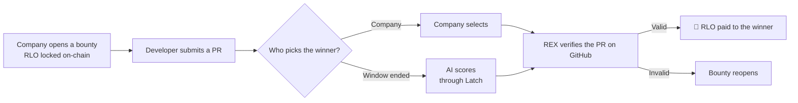
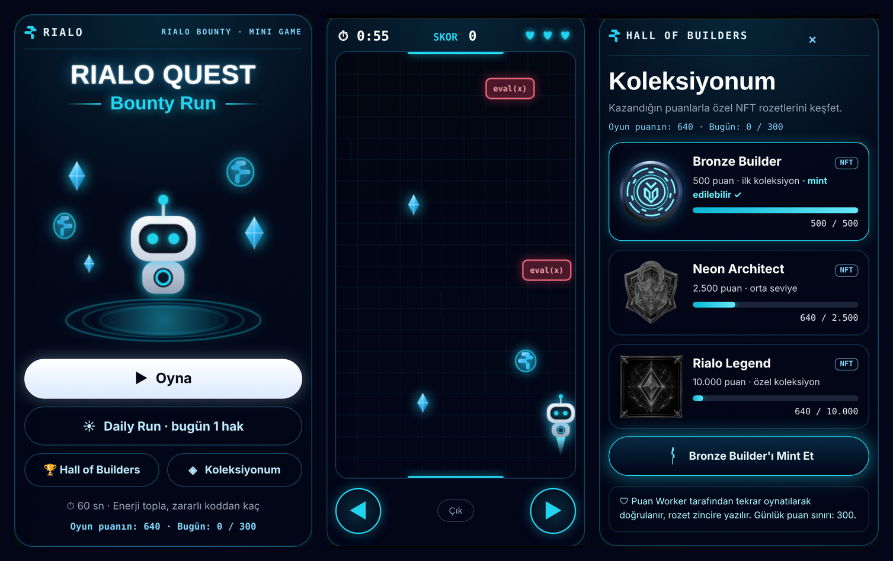
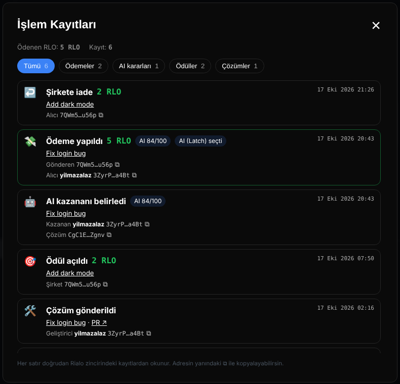

# Rialo Bounty · Devnet

🇹🇷 [Türkçe](README.md) · 🇬🇧 English

**An open-source bounty platform running on Rialo devnet.**
Companies open bounties by locking RLO on-chain, developers submit solutions as GitHub pull requests. The winner is picked by the company or, when the selection window ends, by AI; **Rialo REX** verifies the PR on GitHub and the payout happens on-chain automatically.

🔗 **Live site:** https://cagdasozsahin.github.io/rialobounty-devnet/

> ⚠️ This project runs on **Rialo devnet**. RLO is a test token with no real value. The program has not been independently audited yet.

---

## How it works

1. **Open a bounty** — The company enters a title, description, deadline and RLO amount. The RLO is locked in the program's vault (PDA); nobody can move it by hand.
2. **Submit a solution** — A developer submits the link of a PR opened with their verified GitHub account.
3. **Pick a winner** — The company selects the winner within the selection window. If it doesn't, AI scores the submissions and picks the best one.
4. **REX verifies** — Rialo REX calls GitHub and checks that the PR really belongs to that developer (and is merged, if required).
5. **Payout** — If verification passes, RLO is sent to the winner's wallet automatically. If nobody submits, the RLO is refunded to the company.

Every step advances on-chain by itself through **reactive transactions (heartbeat)**, so the flow completes even when the browser is closed.

---

## Rialo features used

| Feature | What it does here |
| --- | --- |
| **Embedded wallet** | No extension needed. The wallet is created in the browser, protected by a password and can be backed up. With a zero balance, devnet RLO is requested from the faucet automatically. |
| **Native RLO** | Bounties are locked and paid directly in RLO. |
| **Reactive transactions** | Each bounty has its own heartbeat; deadlines, AI verdicts, refunds and verification run on-chain on their own. |
| **REX + Edge** | Reads the PR author and merge status from the GitHub API; every node must produce the same result. |
| **Proof** | The REX result is written on-chain as proof. Funds move only when verification succeeds. |
| **Register (PDA)** | Profiles, bounties, submissions and projects live at deterministic addresses. |
| **Latch** | The LLM key used for AI scoring stays encrypted in Latch; the Worker scores through Latch without ever seeing the key. |

---

## Features

- 🎯 **Bounties** — open a bounty, submit a solution, pick a winner, cancel or refund.
- 🤖 **AI solution review** — PR changes, requirement checks, code quality, security scan and CI results on one screen.
- 👤 **GitHub profile** — connect GitHub and your profile is created from your username and avatar; the account is attested on-chain by the Worker.
- 📦 **Projects** — publish your open-source project and let AI review the repository.
- 🏆 **Leaderboard and points** — daily check-in 10, solution 5, won bounty 100, published project 50 points.
- 🎮 **Rialo Quest** — a 60-second mini game. Points are verified by the Worker replaying the run, and NFT badges are written on-chain.
- 📜 **Transaction log** — bounties, AI verdicts, payouts and refunds are listed publicly with their addresses.
- 🌐 **Turkish / English** interface.

---

## Screenshots

### Rialo Quest

### NFT badges
| Bronze Builder | Neon Architect | Rialo Legend |
| :---: | :---: | :---: |
| 500 points | 2,500 points | 10,000 points |

### Transaction log (transparency)

---

## Try it

1. Open the site: https://cagdasozsahin.github.io/rialobounty-devnet/
2. Click **Create Wallet** and choose a password (don't forget to download the backup).
3. Click **Connect GitHub** — your profile is created automatically.
4. Open a bounty, or submit your PR link to an open one.
5. Play **Rialo Quest** in your spare time, collect points and mint badges.

---

## Chain info (devnet)

| | Address |
| --- | --- |
| Program | `7QWm5Hzxoa78iRb62pzhkpPczPAS87KCSyL1jUmcu56p` |
| REX component | `CgC1EB8Gxj55orzTV8V56wJWpnSFjD9TMd83UsA6Zgnv` |
| AI scorer | `3ZyrPpBZLKU8t38raWDTzW4E9EJKeaD1PtGRaCeHa4Bt` |
| Worker | https://rialobounty-devnet.yilmazc1453.workers.dev |

---

## Security notes

- Payment rules and funds live in the on-chain program; the site is only an interface.
- The AI score is a helper signal, not a guarantee of correctness.
- GitHub attestation, AI scoring and game-score verification run in the Worker (off-chain); the Worker signs only with its own key, and no secrets are stored in this repository.
- An independent security audit is required before mainnet.
