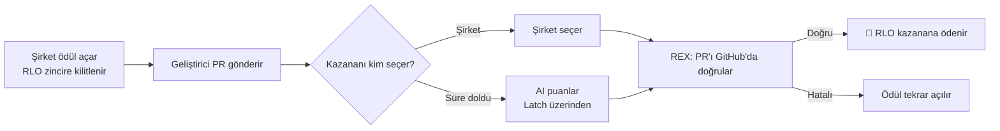

# Rialo Bounty · Devnet

**Rialo devnet üzerinde çalışan açık kaynak ödül (bounty) platformu.**
Şirketler RLO'yu zincire kilitleyerek ödül açar, geliştiriciler GitHub PR'ı ile çözüm gönderir. Kazananı şirket seçer ya da süre dolunca AI belirler; **Rialo REX** PR'ı GitHub üzerinden doğrular ve ödeme zincirde otomatik yapılır.

🔗 **Canlı site:** https://cagdasozsahin.github.io/rialobounty-devnet/

> ⚠️ Bu proje **Rialo devnet** üzerinde çalışır. RLO test tokenıdır, gerçek değeri yoktur. Kontratlar henüz bağımsız bir güvenlik denetiminden geçmemiştir.

---

## Nasıl çalışır?

1. **Ödül aç** — Şirket başlık, açıklama, son tarih ve RLO miktarını girer. RLO programın kasasına (PDA) kilitlenir; kimse elle dokunamaz.
2. **Çözüm gönder** — Geliştirici, doğrulanmış GitHub hesabıyla açtığı PR linkini gönderir.
3. **Kazanan belirlenir** — Şirket seçim süresi içinde kazananı seçer. Seçmezse AI, gönderilen çözümleri puanlar ve en iyisini belirler.
4. **REX doğrular** — Rialo REX, GitHub'a bağlanıp PR'ın gerçekten o kişiye ait olduğunu (ve gerekiyorsa birleştirildiğini) kontrol eder.
5. **Ödeme** — Doğrulama geçerse RLO kazananın cüzdanına otomatik gönderilir. Hiç çözüm gelmezse RLO şirkete iade edilir.

Bu adımların hepsi **reactive transaction (kalp atışı)** ile zincirde kendiliğinden ilerler; tarayıcı kapalı olsa bile süreç tamamlanır.

---

## Kullanılan Rialo özellikleri

| Özellik | Bu projede ne işe yarıyor |
| --- | --- |
| **Dahili cüzdan** | Eklenti gerekmez. Cüzdan tarayıcıda oluşturulur, şifreyle korunur, yedeği indirilebilir. Bakiye 0 ise devnet faucet'ten otomatik RLO alınır. |
| **Yerel RLO** | Ödüller doğrudan RLO ile kilitlenir ve ödenir. |
| **Reactive transactions** | Her ödülün kendi kalp atışı vardır; süre takibi, AI kararı, iade ve doğrulama zincirde kendiliğinden yürür. |
| **REX + Edge** | PR'ın yazarını ve birleştirilme durumunu GitHub API'sinden okur; tüm düğümler aynı sonucu üretmek zorundadır. |
| **Proof** | REX sonucu zincire kanıt olarak yazılır. Para yalnızca doğrulama başarılıysa hareket eder. |
| **Register (PDA)** | Profil, ödül, çözüm ve proje kayıtları deterministik adreslerde tutulur. |
| **Latch** | AI puanlaması için kullanılan LLM anahtarı Latch'te şifreli durur; Worker anahtarı hiç görmeden Latch üzerinden puanlatır. |

---

## Özellikler

- 🎯 **Ödüller** — Ödül aç, çözüm gönder, kazanan seç, iptal/iade.
- 🤖 **AI çözüm incelemesi** — PR'daki değişiklikler, gereksinim kontrolleri, kod kalitesi, güvenlik taraması ve CI sonuçları tek ekranda.
- 👤 **GitHub ile profil** — GitHub'ı bağlayınca kullanıcı adı ve profil resminle profil otomatik oluşur; hesap Worker tarafından zincirde onaylanır.
- 📦 **Projeler** — Kendi açık kaynak projeni yayınla, AI deponu incelesin.
- 🏆 **Sıralama ve puanlar** — Günlük check-in 10, çözüm 5, kazanılan ödül 100, yayınlanan proje 50 puan.
- 🎮 **Rialo Quest** — 60 saniyelik mini oyun. Puanlar Worker tarafından yeniden oynatılarak doğrulanır, NFT rozetleri zincire yazılır.
- 📜 **İşlem kayıtları** — Açılan ödüller, AI kararları, ödemeler ve iadeler adresleriyle birlikte herkese açık listelenir.
- 🌐 **Türkçe / İngilizce** arayüz.

---

## Ekran görüntüleri

### Rialo Quest

### NFT rozetleri
| Bronze Builder | Neon Architect | Rialo Legend |
| :---: | :---: | :---: |
| 500 puan | 2.500 puan | 10.000 puan |

### İşlem kayıtları (şeffaflık)

---

## Nasıl denerim?

1. Siteyi aç: https://cagdasozsahin.github.io/rialobounty-devnet/
2. **Cüzdan Oluştur** ile bir şifre belirle (yedeği indirmeyi unutma).
3. **GitHub Bağla** — profilin otomatik oluşur.
4. Bir ödül aç ya da açık bir ödüle PR linkinle çözüm gönder.
5. Boş vakitte **Rialo Quest** oyna, puan topla, rozet mint et.

---

## Zincir bilgileri (devnet)

| | Adres |
| --- | --- |
| Program | `7QWm5Hzxoa78iRb62pzhkpPczPAS87KCSyL1jUmcu56p` |
| REX bileşeni | `CgC1EB8Gxj55orzTV8V56wJWpnSFjD9TMd83UsA6Zgnv` |
| AI puanlayıcı | `3ZyrPpBZLKU8t38raWDTzW4E9EJKeaD1PtGRaCeHa4Bt` |
| Worker | https://rialobounty-devnet.yilmazc1453.workers.dev |

---

## Güvenlik notları

- Ödeme kuralları ve fonlar zincirdeki programdadır; site yalnızca arayüzdür.
- AI puanı bir yardımcı sinyaldir, doğruluk garantisi değildir.
- GitHub doğrulaması, AI puanlaması ve oyun puanı doğrulaması Worker'da (zincir dışında) çalışır; Worker yalnızca kendi anahtarıyla imzalar, gizli anahtarlar bu depoda bulunmaz.
- Mainnet'ten önce bağımsız güvenlik denetimi gereklidir.

---

## English summary

**Rialo Bounty** is an open-source bounty platform on **Rialo devnet**. Companies lock RLO on-chain; developers submit GitHub PRs; the winner is picked by the company or scored by AI via **Latch**; **Rialo REX** verifies the PR on GitHub and the payout happens automatically through reactive transactions. Includes an embedded wallet, GitHub-based profiles, AI code review, a public transaction log and **Rialo Quest**, a mini game with on-chain NFT badges.

Live: https://cagdasozsahin.github.io/rialobounty-devnet/
